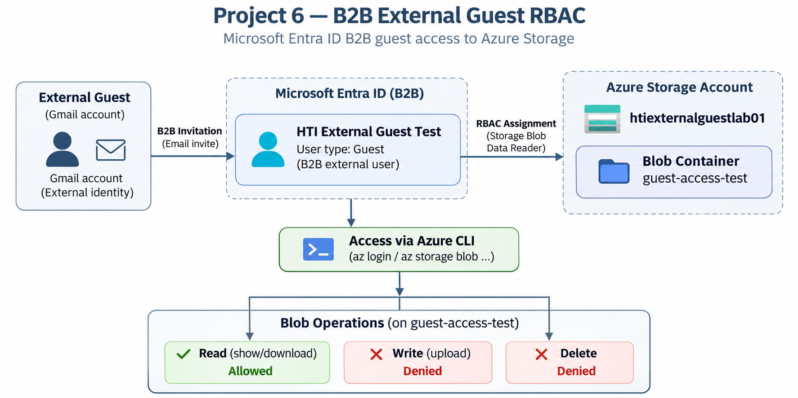

# Project 6 – Azure IAM Architecture

## 1. Overview

This document describes the identity and access management architectures implemented in Project 6.

The project has two related lab components:

1. **Core Azure RBAC** — demonstrates group-based Azure RBAC and least-privilege access within a single Microsoft Entra ID tenant.
2. **B2B External Guest RBAC extension** — extends the project to demonstrate Microsoft Entra ID B2B guest access and scoped read-only access to Azure Blob Storage.

The two exercises are documented separately because the B2B exercise introduces an external guest identity and a different access boundary from the original single-tenant RBAC lab.

---

## 2. Architecture Diagrams

### Core Azure RBAC

The core architecture shows the relationship between the analyst account, Microsoft Entra ID security group, subscription-level Reader role assignment, and the tested access outcomes.

[View or download the scalable SVG core Azure RBAC architecture diagram](project-6-azure-iam-architecture.svg).

### B2B External Guest RBAC

The B2B architecture shows the external Gmail identity being invited through Microsoft Entra ID B2B, represented as a guest identity, assigned the **Storage Blob Data Reader** role on the Azure Storage account, and tested through Azure CLI.

[View or download the scalable SVG B2B external guest RBAC architecture diagram](P6-b2b-external-guest-rbac-architecture.svg).

---

# Part A – Core Azure RBAC

## 3. Core Lab Architecture

The core lab demonstrates group-based Azure RBAC and least-privilege permissions within a single Azure tenant.

The architecture consists of:

- **Microsoft Entra ID:** Provides identity and group management.
- **Security group:** `HTI-P6-Cloud-Security-Analysts`
- **Analyst account:** `hti-p6-analyst`
- **Azure subscription:** `Azure subscription 1`
- **Azure RBAC role:** Built-in Reader role.
- **Assignment scope:** Azure subscription.

## 4. Core Identity and Access Structure

| Component | Configuration |
|---|---|
| Directory | Default Microsoft Entra ID tenant |
| Analyst account | HTI P6 Lab Analyst |
| User type | Member |
| Security group | HTI-P6-Cloud-Security-Analysts |
| Membership type | Assigned |
| Group membership | Analyst account added |
| RBAC role | Reader |
| Assignment target | Security group |
| Assignment scope | Subscription |
| Directory administrative role | None assigned to analyst |

## 5. Core Access Flow

The access model follows this sequence:

1. The administrator creates the analyst account in Microsoft Entra ID.
2. The administrator creates the security group.
3. The analyst account is added to the security group.
4. The Azure Reader role is assigned to the security group at subscription scope.
5. The analyst signs in to Azure.
6. The analyst's subscription access is evaluated through the group-based role assignment.

The role is assigned to the group rather than directly to the individual user.

## 6. Core Permission Validation

The architecture was examined using the Azure portal and Azure Cloud Shell.

| Test | Observed result | Evidence interpretation |
|---|---|---|
| View subscription | Subscription overview displayed | Portal view captured |
| View role assignments | Reader assignment displayed for analyst | Subscription-level role assignment view captured |
| View My permissions | Permissions view displayed | Analyst's access view captured |
| Open IAM Add menu | Add role assignment and Add custom role were disabled | The analyst could not initiate these role-management actions through the captured portal view |
| List resource groups | Command completed with an empty result | Read command succeeded; no resource groups were listed |
| Create resource group | `AuthorizationFailed` | The tested resource-creation operation was denied |

The resource-group listing returned no entries because no resource groups were present in the subscription at the time of capture.

The attempted resource-group creation failed with an authorization error identifying the required `Microsoft.Resources/subscriptions/resourceGroups/write` permission.

The IAM screenshot shows that both **Add role assignment** and **Add custom role** were disabled in the analyst's subscription IAM view. This is evidence of the portal controls available to that account in the captured session; it is not a test of every possible role-management interface or API.

---

# Part B – B2B External Guest RBAC Extension

## 7. B2B Lab Architecture

The B2B extension introduces an external user into the Azure tenant through Microsoft Entra ID B2B and applies least-privilege data access to an Azure Storage account.

The architecture consists of:

- **External identity:** Gmail account used as the B2B external identity.
- **Microsoft Entra ID:** Provides the B2B guest identity.
- **Guest identity:** `HTI External Guest Test`.
- **Azure Storage account:** `htiexternalguestlab01`.
- **Blob container:** `guest-access-test`.
- **RBAC role:** Storage Blob Data Reader.
- **Access method:** Azure CLI.
- **Tested access:** Blob read allowed; blob write and delete denied.

The B2B exercise is an extension of the project rather than a replacement for the original core Azure RBAC implementation.

## 8. B2B Access Flow

The B2B access model follows this sequence:

1. An external Gmail identity is invited to the Azure tenant through Microsoft Entra ID B2B.
2. The invitation is redeemed and the external identity is represented as a guest user.
3. The guest is assigned the **Storage Blob Data Reader** role at the Azure Storage account scope.
4. The guest authenticates through Azure CLI.
5. Blob operations are tested against the `guest-access-test` container.
6. Read access succeeds while write and delete operations are denied.

The RBAC assignment is scoped to the Storage account rather than granting broader subscription-level permissions.

## 9. B2B Permission Validation

| Operation | Expected/observed result | Evidence |
|---|---|---|
| Guest invitation | External guest invitation created | B2B E01 |
| Invitation redemption | Invitation redeemed / guest access established | B2B E02 |
| RBAC assignment | Storage Blob Data Reader assigned at Storage account scope | B2B E03 |
| Azure CLI authentication | CLI authenticated against the Azure tenant/subscription context used for the exercise | B2B E04 |
| Guest identity confirmation | External guest identity and selected Azure context confirmed in the captured CLI evidence | B2B E05 |
| Blob read | Successful | B2B E06 |
| Blob write/upload | Access denied | B2B E07 |
| Blob delete | Access denied | B2B E08 |

The permission tests demonstrate the intended least-privilege boundary: the guest can read Blob data but does not have the tested permissions required to upload or delete Blob data.

## 10. Security Design Principles

Across the two exercises, Project 6 demonstrates:

- **Least privilege:** Access is limited to the role required for the task.
- **Group-based access control:** The core exercise assigns Azure RBAC to a security group rather than directly to the analyst.
- **Scoped access:** The B2B exercise assigns Storage Blob Data Reader at Storage account scope rather than granting broader subscription permissions.
- **Separation of duties:** Administrative configuration is performed separately from the analyst/guest access being tested.
- **Identity-aware access:** Microsoft Entra ID provides the identity context used by Azure RBAC.
- **Permission validation:** Specific portal controls and CLI operations were examined and tested.
- **External collaboration controls:** The B2B extension demonstrates controlled access for an external guest identity.

## 11. Scope and Limitations

### Core Azure RBAC

The core project implements single-tenant Azure identity and access management.

It does not implement:

- Cross-tenant B2B collaboration within the core exercise.
- Guest-user access from an external tenant.
- Custom Azure RBAC roles.
- Production workloads or deployed Azure resources.
- A Conditional Access policy enforcing MFA.

The CLI tests cover the specific list and create operations shown. The IAM screenshot documents disabled portal controls in the captured analyst session; it does not independently establish restrictions across all Azure interfaces or APIs.

### B2B External Guest RBAC

The B2B extension is a controlled lab exercise demonstrating external guest access to Azure Blob Storage.

It does not represent:

- A production B2B collaboration deployment.
- A production data-sharing configuration.
- A comprehensive test of every Azure Storage permission or API.
- A test of permissions outside the `guest-access-test` container and configured Storage account scope.
- A Conditional Access or MFA enforcement implementation.

The access conclusions are limited to the operations actually tested and captured in the B2B evidence set.

---

## 12. Conclusion

Project 6 demonstrates two complementary Azure identity and access management patterns.

The **core exercise** demonstrates group-based Azure RBAC and least-privilege subscription access within a single tenant.

The **B2B extension** builds on that foundation by introducing an external guest identity and applying a narrowly scoped Storage Blob Data Reader role. The guest successfully performed the tested read operation while write and delete operations were denied.

Together, the two exercises provide practical evidence of identity-based access control, RBAC scoping, least privilege, and permission validation across both internal and external-user scenarios.
