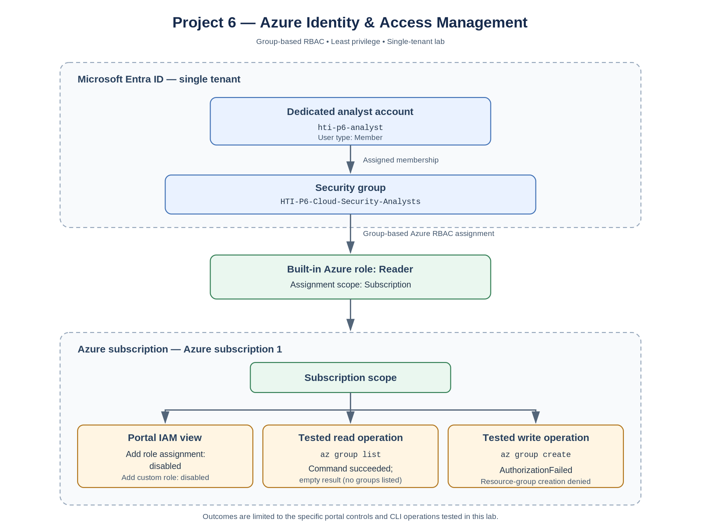

# Project 6 – Azure IAM Architecture

## 1. Overview

This document describes the identity and access management architecture implemented in Project 6.

The lab demonstrates how Microsoft Entra ID security groups and Azure Role-Based Access Control (RBAC) can be combined to implement group-based access and least-privilege permissions within a single Azure tenant.

The implementation assigns the built-in Reader role to a security group at subscription scope. It then examines the analyst account's effective access and tests selected read and write operations.

## 2. Lab Architecture

The architecture consists of:

- **Microsoft Entra ID:** Provides identity and group management.
- **Security group:** `HTI-P6-Cloud-Security-Analysts`
- **Analyst account:** `hti-p6-analyst`
- **Azure subscription:** `Azure subscription 1`
- **Azure RBAC role:** Built-in Reader role.
- **Assignment scope:** Azure subscription.

### Architecture diagram

[View or download the scalable SVG architecture diagram](project-6-azure-iam-architecture.svg).

## 3. Identity and Access Structure

| Component | Configuration |
|---|---|
| Directory | Default Microsoft Entra ID tenant |
| Analyst account | HTI P6 Lab Analyst |
| User type | Member |
| Security group | HTI-P6-Cloud-Security-Analysts |
| Membership type | Assigned |
| Group membership | Analyst account added |
| RBAC role | Reader |
| Assignment target | Security group |
| Assignment scope | Subscription |
| Directory administrative role | None assigned to analyst |

## 4. Access Flow

The access model follows this sequence:

1. The administrator creates the analyst account in Microsoft Entra ID.
2. The administrator creates the security group.
3. The analyst account is added to the security group.
4. The Azure Reader role is assigned to the security group at subscription scope.
5. The analyst signs in to Azure.
6. The analyst's subscription access is evaluated through the group-based role assignment.

The role is assigned to the group rather than directly to the individual user.

## 5. Permission Validation

The architecture was examined using the Azure portal and Azure Cloud Shell.

| Test | Observed result | Evidence interpretation |
|---|---|---|
| View subscription | Subscription overview displayed | Portal view captured |
| View role assignments | Reader assignment displayed for analyst | Subscription-level role assignment view captured |
| View My permissions | Permissions view displayed | Analyst's access view captured |
| Open IAM Add menu | Add role assignment and Add custom role were disabled | The analyst could not initiate these role-management actions through the captured portal view |
| List resource groups | Command completed with an empty result | Read command succeeded; no resource groups were listed |
| Create resource group | `AuthorizationFailed` | The tested resource-creation operation was denied |

The resource-group listing returned no entries because no resource groups were present in the subscription at the time of capture.

The attempted resource-group creation failed with an authorization error identifying the required `Microsoft.Resources/subscriptions/resourceGroups/write` permission.

The IAM screenshot shows that both **Add role assignment** and **Add custom role** were disabled in the analyst's subscription IAM view. This is evidence of the portal controls available to that account in the captured session; it is not a test of every possible role-management interface or API.

## 6. Security Design Principles

This implementation demonstrates:

- **Least privilege:** The analyst receives the built-in Reader role rather than Contributor or Owner.
- **Group-based access control:** The role assignment targets a security group rather than an individual account.
- **Separation of duties:** Administrative configuration is performed separately from the analyst's access.
- **Subscription-level RBAC:** The role assignment is made at subscription scope.
- **Permission validation:** Specific portal controls and CLI operations were examined and tested.

## 7. Scope and Limitations

This project implements single-tenant Azure identity and access management.

It does not implement:

- Cross-tenant B2B collaboration.
- Guest-user access from an external tenant.
- Custom Azure RBAC roles.
- Production workloads or deployed Azure resources.
- A Conditional Access policy enforcing MFA.

The CLI tests cover the specific list and create operations shown. The IAM screenshot documents disabled portal controls in the captured analyst session; it does not independently establish restrictions across all Azure interfaces or APIs.

These areas are outside the scope of this lab and may be explored in subsequent projects.

## 8. Conclusion

The lab demonstrates group-based Azure RBAC and least-privilege access in a single-tenant environment.

The evidence includes the analyst's group membership, the subscription-level Reader role assignment view, disabled role-management options in the analyst's IAM portal view, a successful resource-group listing that returned an empty result, and an authorization denial for the tested resource-group creation operation.

This provides practical evidence of how Microsoft Entra ID and Azure RBAC can be used together to manage access within an Azure environment.
